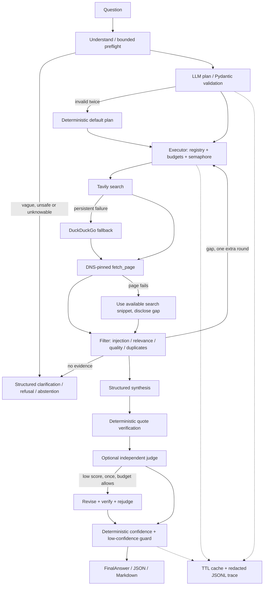

# Evidence-first Research Agent

A small Python research agent that plans a question, discovers and reads sources, filters weak evidence, synthesizes a typed answer, checks its quotations, and optionally asks a separate model judge for one bounded revision. A handwritten state machine keeps orchestration visible. It includes a CLI, a local FastAPI service, offline fixtures, fault tests, an evaluation against a single-call baseline, and auditable JSONL traces. This is a production-oriented assignment submission, not a service ready for public deployment.

**Start offline.** Committed samples and results are actual executions of authored mocks, clearly labeled **MOCK RUN**. They establish reproducibility and failure behavior, not current facts, live model quality, calibrated confidence, or live latency. No API keys were available during development. See [EVALUATION.md](EVALUATION.md) for measured successes and failures.

## Quickstart: four commands

Python 3.11+ is required. From the repository root:

```sh
python -m venv .venv
source .venv/bin/activate
python -m pip install -e ".[dev]"
research-agent research "Compare the top 3 open-source vector databases for a startup building RAG products." --mock
```

On PowerShell, replace the activation command with `.\.venv\Scripts\Activate.ps1`. If execution policy prevents activation, invoke `.\.venv\Scripts\python.exe -m research_agent.cli` directly. The Windows development extra supplies GNU Make; `python scripts/tasks.py test` also works without Make. For the exact dependency versions used here, install [uv](https://docs.astral.sh/uv/) and use `uv sync --extra dev --frozen` instead of pip. The lockfile was generated on Python 3.13; source syntax targets 3.11.

```sh
make test
make lint
make eval
make demo
```

Each has a portable equivalent: `python scripts/tasks.py test`, `lint`, `eval`, or `demo`.

## Live providers

Copy `.env.example` to `.env`, set `RA_LLM_PROVIDER=openai`, `RA_OPENAI_API_KEY`, and `RA_TAVILY_API_KEY`. For Claude use `RA_LLM_PROVIDER=anthropic` and `RA_ANTHROPIC_API_KEY`. Select compatible model IDs through `RA_OPENAI_MODEL` / `RA_ANTHROPIC_MODEL` and their judge counterparts. Defaults are examples of structured-output-capable models, not a promise of access or the latest models. Missing Tavily credentials cause a recorded fallback to DuckDuckGo; missing LLM credentials fail clearly at startup. Keys are read only from environment or the ignored local `.env` file.

```sh
research-agent research "Compare different approaches to adding memory in an AI support agent." --json --output answer.json
python eval/run_eval.py --live
```

Live evaluation writes to `eval/results/live/`, preserving mock results. It skips synthetic fault scenarios rather than labeling fixture content as live research. Run `--mock` to exercise all faults. Live provider wire formats are tested with HTTP mocks; real credentials are still needed for an end-to-end live smoke test.

Provider implementations use native schema output over `httpx`: [OpenAI Responses structured outputs](https://developers.openai.com/api/docs/guides/structured-outputs) and [Claude JSON outputs](https://platform.claude.com/docs/en/build-with-claude/structured-outputs). Returned JSON is always validated again with Pydantic. [Tavily search](https://docs.tavily.com/documentation/api-reference/endpoint/search) discovers sources; `ddgs` is the independent fallback.

## Architecture



`agent.py` expresses stage transitions. `collector.py` owns the two-round retrieval loop; `review.py` owns synthesis, verification, judge and revision. Mutable per-run state is local; cache and provider circuits may be shared across API requests. The planner chooses bounded queries and whether to read pages; the executor enforces tool allowlisting, argument schemas and limits. A fetched page cannot add tools, edit the plan or execute code. The gap check needs two distinct candidate domains per sub-question, a useful coverage proxy rather than proof of agreement.

The fixed `FinalAnswer` includes question, short answer, findings with quotes and source IDs, optional comparison rows, sources with provenance and retrieval time, deterministic confidence factors, assumptions, limitations, next steps, and run metadata. Missing optional values appear as JSON `null`. Results retain only sources referenced by verified findings.

## CLI and API

```sh
research-agent research "Find 5 Indian B2B SaaS startups in HR tech and summarize their positioning." --mock --output answer.json
research-agent research "Compare vector databases for RAG products." --mock --scenario timeout --output degraded.json
research-agent trace TRACE_ID_FROM_OUTPUT
make serve
```

`--json` emits final JSON only on stdout. Human output shows the plan, tool outcomes, fallback/security/gap events, verified findings and stage timings. This compact CLI displays events after execution; the JSONL trace is written during execution.

```sh
curl http://127.0.0.1:8000/health
curl -X POST http://127.0.0.1:8000/research -H "Content-Type: application/json" -d '{"question":"Compare vector databases for RAG products."}'
curl http://127.0.0.1:8000/traces/TRACE_ID
```

PowerShell alternative: `Invoke-RestMethod -Method Post -Uri http://127.0.0.1:8000/research -ContentType application/json -Body '{"question":"Compare vector databases for RAG products."}'`.

## 1. Why did you choose an agentic approach here?

Research needs a sequence of dependent decisions: what is missing, which sources to retrieve, whether to read a page, and whether enough evidence exists. A single prompt cannot establish fresh facts without retrieval. Planning, execution, evidence filtering and verification make these decisions reviewable. This is one bounded agent with an independent judge, not a network of autonomous agents. The baseline uses exactly one model call and no tools, so the evaluation separates evidence collection from a no-retrieval answer.

## 2. What tools did you use, and why?

`web_search` discovers candidates through Tavily and DuckDuckGo. `fetch_page` reads the highest-scoring candidates through async HTTP and extracts text with trafilatura. They are separate because search snippets can omit context, while fetching every result wastes latency and expands the attack surface. All tool arguments, data and `ToolResult` envelopes have Pydantic schemas. Tools and models are injected behind protocols; `MockLLM`, `MockSearch` and `MockFetch` need no network or keys.

## 3. How does the system handle bad tool results?

| Failure | Behavior |
| --- | --- |
| Tavily down, missing key or malformed result | Bounded retries where transient, then independent provider fallback |
| Every search provider fails or returns empty results | Structured insufficient-evidence answer; no invented sources/findings |
| Some pages fail | Keep usable snippets; disclose missing full pages and lower confidence via failures |
| Invalid arguments or unknown tool | Reject before execution; record the evidence gap |
| 429, 5xx, transport timeout | Exponential backoff with jitter; provider-specific circuit breaker |
| 4xx other than 429, validation, unsafe URL, injection | No retry; record permanent failure or quarantine |
| Invalid LLM JSON/schema | One bounded repair with safe validation feedback; planner defaults, synthesis abstains |
| Judge failure | Keep verified answer; substitute conservative judge signal and disclose it |
| Token/call/page/time budget exhaustion | Return partial best effort and flag it explicitly |
| Malformed/empty/oversized page | Uniform failure envelope; no body enters synthesis |

Defaults: 4 concurrent tools, 16 external tool attempts including retries/fallbacks, 6 page attempts, 90 seconds, 32,000 conservatively reserved tokens, 12 seconds per tool attempt, 25 seconds per model attempt, 2 transient retries, 1 output repair, 2 retrieval rounds, 1 revision. A page attempt permits at most 3 redirects. Token reservations include UTF-8 byte counts of prompts/schema plus output allowance and framing; this intentionally overestimates common English tokenization. Timed-out model attempts retain their reservation because billing may still occur. CPU parsing and trace cleanup can add small time beyond the cooperative deadline.

## 4. How do you reduce hallucinations?

1. Prefer relevant primary-style sources and remove duplicates/spam before synthesis.
2. Give synthesis only retained evidence, with explicit untrusted-data boundaries and versioned instructions.
3. Require an exact supporting quote on every finding. Normalize Unicode, whitespace and case, then require the quote to occur in **every** cited source. Missing IDs and fabricated quotes fail closed.
4. Remove failed findings; reconstruct the short answer and comparison observations from retained findings, so free-form summaries/table cells cannot bypass citation checks.
5. Ask a separate judge about faithfulness, completeness, quality and clarity; allow one verified revision.
6. Compute confidence from observable signals and hedge low-confidence answers.

**Quote presence proves provenance, not entailment or truth.** A misleading claim can quote a real sentence. Judge/human review is still required, and vendor documentation may be biased. The conservative comparison renderer uses one supported-observation column; arbitrary multi-criteria model cells are deliberately not published without cell-level grounding. Richer comparison matrices are a future schema extension.

Source ranking: 35% lexical relevance + 30% domain/path reputation heuristic + 25% text length quality + 10% recency; affiliate/SEO patterns incur a 0.55 penalty. Unknown dates get a neutral 0.5 recency signal. Publication-date support exists in schemas, but current search adapters do not infer dates. Canonical URLs remove tracking parameters while preserving meaningful queries. Near-duplicates use normalized-text similarity. Recognized documentation paths are heuristics, not authenticity checks.

Confidence formula in `pipeline/confidence.py`:

```text
score = .20 independent_domains + .15 average_source_quality
      + .25 grounding_rate + .10 cross_source_agreement_proxy
      + .10 judge_score + .10 tool_health + .10 gap_coverage
```

Independent high-quality domains saturate at 3. Agreement is the average number of distinct domains cited per finding, saturated at 2; it is **not semantic consensus**. Gap coverage is `1/(1+gaps)`. Tool health reflects failed attempts, including recovered failures. Missing/disabled judge uses 0.4. No-findings results cap at 0.2; mock runs cap at 0.5. High begins at 0.8, medium at 0.55; the configurable guard threshold defaults to 0.55. This score is a monotonic prioritization heuristic, not a calibrated probability.

## 5. How would you make this production-ready?

Add authentication, authorization, per-tenant admission/rate limits, request-level concurrency limits, queue/workers, persistent isolated cache, trace retention and encrypted storage. Put fetches behind an egress proxy with a vetted allowlist and network policy. Replace synchronous fallback threads with an async search provider or killable worker. Calibrate confidence against human judgments, add claim-entailment and contradiction evaluations, and send low-confidence decisions to human review. Add CI regression evals, version prompts/model snapshots, use canary rollouts, and track eval dashboards before increasing traffic. Keep follow-up memory out until tenant isolation, retention and privacy requirements are defined.

## 6. What would you monitor in production?

The JSONL events map to spans in OpenTelemetry/Langfuse and model request metrics in Helicone. Export counts/histograms from stage, tool, LLM, retry, security and confidence events. Suggested starting alerts (not measured SLOs):

| Signal | Starting alert |
| --- | --- |
| Overall and per-stage p50/p95 latency | p95 > 60 s for 15 min; investigate stage contribution |
| Estimated cost/query and reported token use | 2x rolling seven-day median, with model/rate labels |
| Provider error/timeout rate | > 10% over 5 min, minimum 50 attempts |
| Grounding rate | < 95% of attempted claims over 1 h |
| Low-confidence and abstention rate | +20 percentage points over baseline |
| Judge score distribution | median < 0.7 over 100 judged answers |
| Injection flags | burst above baseline; investigate blocked domains |
| Cache hit rate | fall > 30 percentage points at stable query mix |
| User feedback / human overrides | increased incorrect-answer reports by task type |

Trace IDs join stages and provider calls. Each model event includes model, input/output tokens, elapsed time and configured-rate cost estimate. Full prompts, fetched bodies and provider error bodies are not logged. Common secret assignments, API-token patterns, URL credentials and emails are redacted; this is best-effort redaction, not a comprehensive PII detector. Traces can still contain sensitive research topics: protect access and retention.

## 7. What were your key tradeoffs?

- **Custom orchestration vs framework:** a small state machine exposes transitions, budgets and fallback behavior without LangChain/LangGraph dependencies. Each stage could later become a graph node if durable workflows become necessary.
- **Deterministic vs model-reported confidence:** reproducible factors are inspectable; their weights and agreement proxy need real calibration.
- **Judge vs speed:** a normal answered run uses plan + synthesis + judge (three model calls). Disable `RA_JUDGE_ENABLED` for two calls. A low score may add one revision and one rejudge; both remain budgeted.
- **Depth vs latency:** async discovery and top-page reads amortize network waits; only one gap round is allowed. Prefix truncation keeps evidence small but may omit a crucial caveat deep in a page. No embedding service or vector database is required.
- **Snippets vs full text:** snippets enable graceful degradation but can be incomplete. Provenance and limitations disclose this. The process-local TTL cache avoids repeat search/page calls for an API session; separate CLI processes intentionally start cold. No persistent private browsing data is stored in cache.
- **Conservative comparison vs rich tables:** verified observations are less polished than arbitrary model-generated matrices, but summaries/table cells cannot become uncited claims.

## Security boundaries and known limitations

The injection detector quarantines entire suspicious sources, including raw HTML containing hidden/zero-width instructions. It checks before truncation and again in filtering. Retrieved data never enters the planner. Delimiters, schemas and an allowlisted executor reduce risk; they do **not** eliminate prompt injection and may overblock legitimate security discussions. The preflight is a small heuristic, not a comprehensive moderation or intent classifier; ambiguous requests outside its known patterns may need better clarification.

Fetch permits only HTTP(S) on ports 80/443, blocks credentials/private/loopback/link-local/mapped IPs and mixed private/public DNS results, pins the connection to an approved IP while preserving Host/TLS SNI, and checks every redirect. Environment proxies are disabled. Responses are bounded by bytes, type and time; compressed responses are rejected to avoid decompression bombs. There is no JavaScript rendering, authenticated browsing, robots policy engine, paywall bypass, PDFs or file downloads. Some sites will reject IP-pinned requests or disallow extraction.

The `ddgs` fallback runs in a thread with its own timeout; coroutine cancellation does not forcibly kill that thread. Per-run budgets are not fleet-wide quotas. Cache/circuits are process-local, and simultaneous requests may exceed the per-run semaphore globally. The API has no auth and should stay on loopback. Local trace I/O and HTML extraction are synchronous short operations. Available disk storage is a deployment prerequisite. Estimated costs cover known successful **model** responses only; search billing, timed-out billing and infrastructure are excluded. Unconfigured rates produce `null`, not a claim of zero cost.

## Evaluation and submission guide

- [EVALUATION.md](EVALUATION.md): actual results, failed checks, denominators, and live-run checklist.
- [eval/queries.yaml](eval/queries.yaml): 12 questions with expected behavior, machine criteria and human failure-review criteria.
- [eval/results/mock/summary.md](eval/results/mock/summary.md): per-query agent/baseline metrics.
- [samples/](samples/): three executed mock outputs, Markdown renderings and redacted trace snapshots.
- [DEMO_SCRIPT.md](DEMO_SCRIPT.md): exact commands and a four-minute recording script.
- [SUBMISSION.md](SUBMISSION.md): repository tree, requirement-to-code checklist, verification and remaining handoff tasks.

Future improvements: cell-level comparison citations, model-independent entailment checking, source-date extraction, contradiction-aware synthesis, human-labeled relevance data, semantic retrieval only when justified, persistent cache/worker orchestration, and end-to-end live regression runs. No follow-up memory was added; the focused retrieval and reliability work takes priority.
