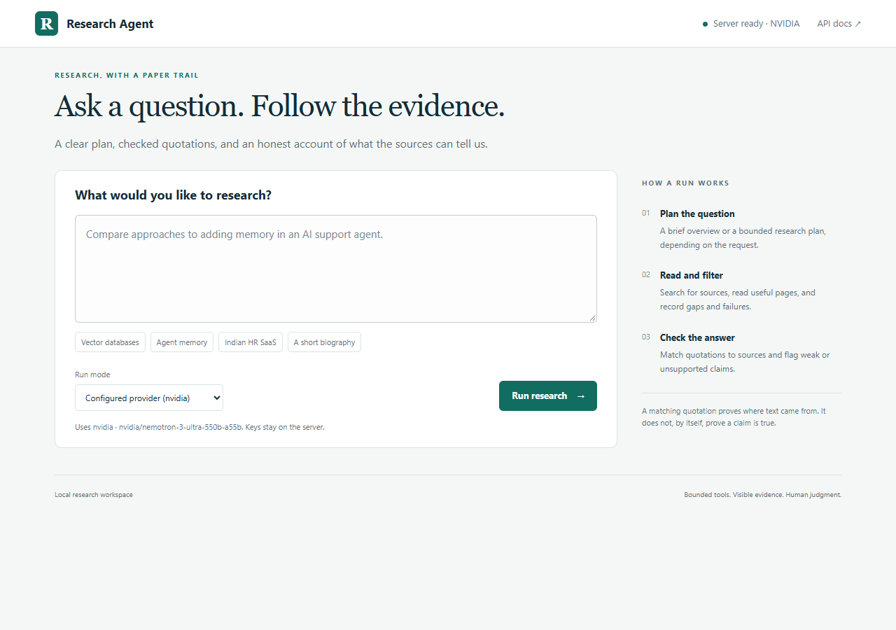
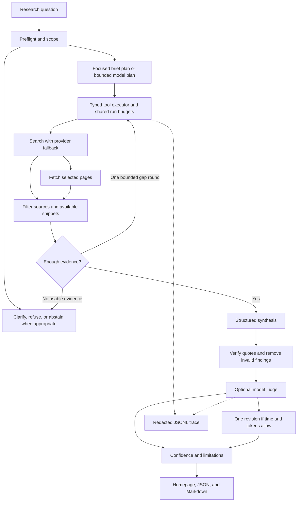
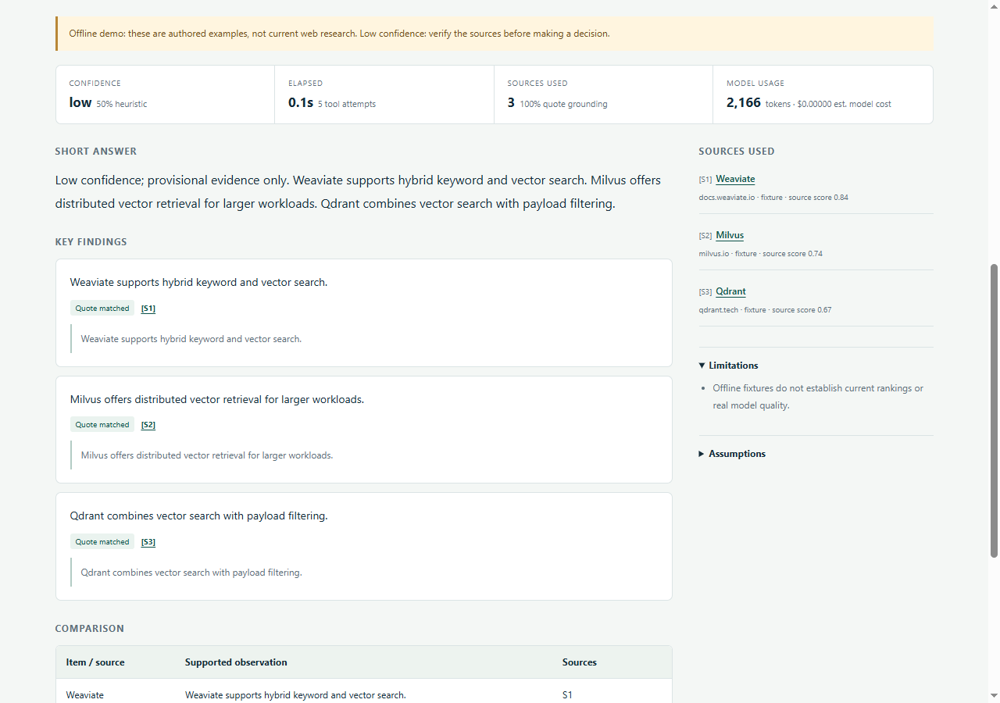

# Evidence-First Research Agent

**A bounded AI research workflow that turns questions into cited, inspectable research drafts.**


[](VERIFICATION.md)

Plan a question, search the web, read useful sources, verify quotations, and inspect how the answer was produced. The project combines a handwritten agent workflow with a local web interface, a CLI, typed API responses, and reproducible offline evaluation.

[Quickstart](#quickstart) · [Architecture](#architecture) · [Evaluation](#validation-and-evaluation) · [Demo guide](DEMO_SCRIPT.md) · [Engineering notes](docs/ENGINEERING.md)



*Actual local interface. The configured provider is shown in the header; credentials remain on the server.*

## What the project delivers

- **Evidence-backed drafts:** findings include source IDs, supporting quotations, provenance, and retrieval metadata.
- **Bounded orchestration:** explicit stages enforce tool, page, token, retry, and wall-clock limits. Short identity questions use a focused brief plan.
- **Resilient retrieval:** Tavily search, DuckDuckGo fallback, bounded page fetching, deduplication, and source-quality filtering.
- **Structured recovery:** Pydantic validation, one repair allowance, and preservation of valid findings when another finding is malformed.
- **Reviewable quality signals:** literal quotation checks, an optional separate model judge, source attribution, and deterministic confidence factors.
- **Usable interfaces:** a responsive homepage, FastAPI endpoints, and a CLI with JSON/Markdown output and trace inspection.
- **Reproducible demonstrations:** authored offline fixtures for successful runs, provider timeouts, search failures, and injection attempts.
- **Observable execution:** redacted JSONL traces record plans, tool outcomes, retries, stage latency, model usage, and available cost estimates.

This is a **production-oriented reference implementation** built for a platform engineering assignment. The API is intended for local use; public deployment requires additional access controls and infrastructure.

## Quickstart

Requires **Python 3.11+**. Run the commands from the repository root. The offline demo needs no API keys or live inference; initial dependency installation needs network access.

### Windows · VS Code PowerShell

```powershell
python -m venv .venv
.\.venv\Scripts\python.exe -m pip install -e ".[dev]"
if (!(Test-Path .env)) { Copy-Item .env.example .env }
.\.venv\Scripts\python.exe -m research_agent.cli demo --mock --port 8001
```

### macOS / Linux

```bash
python3 -m venv .venv
.venv/bin/python -m pip install -e ".[dev]"
[ -f .env ] || cp .env.example .env
.venv/bin/python -m research_agent.cli demo --mock --port 8001
```

The launcher opens [the local homepage](http://127.0.0.1:8001/) automatically. Choose **Vector databases**, then **Run research**. The result shows findings, quotes, sources, confidence, limitations, and an expandable **Plan & tool activity** timeline.

Use **Save JSON** or **Save Markdown** to export a result. Export links use a bounded in-memory cache: 64 results and a one-hour TTL by default, cleared on server restart. Keep the launcher terminal open; **Ctrl+C** stops a server started by that launcher. A compatible existing server is reused.

For the locked development environment, use `uv sync --extra dev --frozen` instead of the pip installation step. Source syntax targets Python 3.11+; executed local verification used Python 3.13.15.

### Already installed?

To open the configured provider from PowerShell:

```powershell
.\.venv\Scripts\python.exe -m research_agent.cli demo
```

The default address is [http://127.0.0.1:8000/](http://127.0.0.1:8000/). The homepage is the demonstration interface; `/docs` remains available for API exploration. Use `--port 8001` when another service occupies the default port, or `--no-browser` to suppress automatic opening.

## Live provider configuration

Copy `.env.example` to `.env` only if the local file does not already exist. Set credentials locally and restart the server after changes. `.env` and local variants are excluded from Git; `.env.example` is the shareable configuration template.

### NVIDIA Nemotron

```env
RA_LLM_PROVIDER=nvidia
RA_NVIDIA_API_KEY=replace_with_your_nvidia_key
RA_NVIDIA_MODEL=nvidia/nemotron-3-ultra-550b-a55b
RA_NVIDIA_JUDGE_MODEL=nvidia/nemotron-3-ultra-550b-a55b
RA_LLM_TIMEOUT_SECONDS=60
RA_MAX_WALL_SECONDS=180
```

Use a hosted key with access to the selected [NVIDIA model endpoint](https://build.nvidia.com/nvidia/nemotron-3-ultra-550b-a55b). Account access, availability, and quotas depend on the provider. The adapter uses JSON mode followed by application-side schema validation and repair; JSON mode does not guarantee strict schema compliance.

### OpenAI or Anthropic

Set `RA_LLM_PROVIDER=openai` with `RA_OPENAI_API_KEY`, or `RA_LLM_PROVIDER=anthropic` with `RA_ANTHROPIC_API_KEY`. Provider and judge model IDs are configurable through the corresponding settings in [.env.example](.env.example). The adapters use provider structured-output formats and validate returned data again with Pydantic.

### Search and execution limits

Set `RA_TAVILY_API_KEY` for Tavily search. Missing Tavily credentials trigger a recorded DuckDuckGo fallback; missing credentials for the selected live LLM provider fail clearly at startup.

Configuration defaults include 16 tool attempts, 6 page attempts, 32,000 tokens, 90 seconds per run, and at most two retrieval rounds. The NVIDIA example above deliberately allows longer live calls. Successful responses settle token reservations to reported usage; uncertain failed or timed-out attempts retain their reservation. Optional revision is skipped without sufficient token and time headroom.

Live cost estimates remain **unknown** unless model rates are configured. Provider access is not labeled free automatically. See [all settings](src/research_agent/config.py) and the [budget design](docs/ENGINEERING.md#3-how-does-the-system-handle-bad-tool-results).

## Architecture



The orchestration is handwritten rather than delegated to an agent framework. The [orchestrator](src/research_agent/agent.py), [collector](src/research_agent/pipeline/collector.py), and [review stage](src/research_agent/pipeline/review.py) expose the transitions and failure paths directly. Each run owns its mutable state; provider circuits and bounded caches may be shared within an API process.

Retrieved pages are untrusted data. They cannot register tools, change the plan, or execute code. A retained finding must cite a quotation present in its referenced evidence; summaries and comparison observations are rebuilt from retained findings.

## Results you can inspect



*Authored offline vector-database example. The visible mock label and capped confidence distinguish fixture behavior from live research.*

- [Vector database comparison](samples/vector.md) — three cited observations and a comparison structure.
- [Indian HR SaaS research](samples/hr_saas.md) — five fixture-backed positioning summaries.
- [All search providers fail](samples/failure.md) — structured abstention with no invented sources.
- [NVIDIA integration records](eval/results/approved-upgrade/REPORT.md) — actual live outputs, traces, and observed quality/latency limitations.

Offline fixtures validate workflow behavior. They do not establish current product rankings, company facts, or live model quality.

## Validation and evaluation

The latest executed verification records:

- **88 passing offline tests**, covering pipeline behavior, provider adapters, recovery, security boundaries, API modes, exports, and launcher behavior.
- **Ruff and Pyright checks passed.** These are recorded local checks; the repository does not claim a hosted CI status.
- **24 structurally valid evaluation outputs:** 12 questions evaluated with the agent and a single-call, no-tool baseline.
- **10/12 agent behavior checks passed**, compared with **4/12** for the baseline.
- **Two known mock completeness failures remain visible:** concrete downsides were omitted in two cases, despite matching quotations.

The behavior counts are **not accuracy scores**. Mock model usage and judge values are synthetic. Live NVIDIA checks establish integration only: one recorded memory run reached its configured 100-second deadline and returned a correctly labeled partial draft.

Read the [evaluation methodology and failed checks](EVALUATION.md), [per-query results](eval/results/mock/summary.md), and [executed verification record](VERIFICATION.md).

### Reproduce local checks

```powershell
.\.venv\Scripts\python.exe scripts/tasks.py test
.\.venv\Scripts\python.exe scripts/tasks.py lint
.\.venv\Scripts\python.exe scripts/tasks.py eval
```

With an activated environment, the equivalent targets are `make test`, `make lint`, `make eval`, and `make demo`. `make demo` runs the offline CLI demonstration; `research-agent demo` starts the browser interface. The portable task runner also works when Make is unavailable.

## CLI and API

### CLI examples

```powershell
.\.venv\Scripts\python.exe -m research_agent.cli research "Compare vector databases for a startup RAG product." --mock --output answer.json
.\.venv\Scripts\python.exe -m research_agent.cli research "Compare approaches to adding memory in an AI support agent." --output live-answer.json
.\.venv\Scripts\python.exe -m research_agent.cli research "Compare vector databases for RAG products." --mock --scenario timeout --output recovered.json
.\.venv\Scripts\python.exe -m research_agent.cli trace TRACE_ID_FROM_OUTPUT
```

Use `--json` for final JSON on stdout. Human-readable CLI output includes a compact execution summary after completion; the JSONL trace is written during execution.

### HTTP interface

The homepage and API use the same FastAPI process:

- `GET /` — question form and formatted results.
- `GET /health` — provider/model and service readiness metadata, without credentials.
- `POST /research` — a validated `FinalAnswer` response.
- `GET /traces/{trace_id}` — recorded plan and execution events.
- `GET /exports/{trace_id}/json` or `/markdown` — downloads for a recent HTTP result.
- `POST /render/markdown` — render a supplied, validated answer.
- `GET /docs` — interactive API documentation.

Example offline request from PowerShell, while the server is running on port 8001:

```powershell
Invoke-RestMethod -Method Post -Uri http://127.0.0.1:8001/research -ContentType 'application/json' -Body '{"question":"Compare vector databases for RAG products.","mode":"mock","scenario":"normal"}'
```

Failure demonstrations require `mode: "mock"`; scenarios are `normal`, `timeout`, `all_fail`, and `injection`. For live research, leave mode at its `configured` default. [FinalAnswer](src/research_agent/schemas.py) defines findings, sources, confidence, assumptions, limitations, suggested next steps, and run metadata.

## Project structure

```text
src/research_agent/
  agent.py                 Workflow orchestration
  api.py, cli.py, demo.py   HTTP, terminal, and browser entry points
  schemas.py, config.py    Typed contracts and configuration
  budget.py, resilience.py Resource limits, retries, and circuits
  llm/                    Provider adapters and validated model gateway
  pipeline/               Planning, collection, filtering, synthesis, review
  tools/                  Search and bounded page fetching
  safety/                 Injection heuristics and URL/SSRF guards
  web/                    Local HTML, CSS, and JavaScript interface
  tracing.py, renderer.py  Trace records and Markdown output
tests/                    Offline unit, integration, and fault tests
eval/                     Query rubrics, baseline comparison, and results
samples/                  Executed mock answers and redacted traces
docs/                     Engineering notes, upload guide, and screenshots
scripts/                  Portable tasks, evaluation report, source packaging
```

## Engineering decisions

<details>
<summary><strong>Review the seven engineering design decisions</strong></summary>

## 1. Why did you choose an agentic approach here?

Research requires dependent decisions: what is missing, which sources to retrieve, and whether the evidence is sufficient. A bounded planner/executor makes these decisions inspectable and separates retrieval from synthesis. The no-tool baseline provides a comparison with a single model call.

## 2. What tools did you use, and why?

`web_search` discovers candidates through Tavily and DuckDuckGo; `fetch_page` retrieves selected pages and extracts readable text. Separating discovery from reading limits unnecessary work and makes failures visible. Typed protocols allow deterministic model/search/fetch substitutes for offline testing.

## 3. How does the system handle bad tool results?

Uniform result envelopes distinguish success, permanent failure, and transient failure. Only transient errors retry within shared budgets; provider fallback and circuits handle repeated failures. Usable snippets can preserve partial evidence. When no evidence remains, the agent abstains with a valid structured answer.

## 4. How do you reduce hallucinations?

Filter evidence before synthesis, validate model output, require literal supporting quotes, remove invalid findings, and rebuild summaries/comparisons from the retained set. A separate judge can remove unsupported claims and request one bounded revision. Explicit source attribution and limitations expose uncertainty. Quote matching establishes provenance, not entailment or truth.

## 5. How would you make this production-ready?

Add authentication, tenant isolation, global admission controls, asynchronous workers, durable storage, encrypted trace retention, and an isolated egress boundary. Calibrate confidence using human-labeled evaluations and add deployment regression gates before increasing traffic.

## 6. What would you monitor in production?

Track overall/per-stage latency, provider error rates, token use, configured-rate cost estimates, grounding, abstentions, judge distributions, security events, and cache hit rates. Trace IDs already connect stage, tool, and model events. OpenTelemetry/Langfuse/Helicone export is a proposed extension, not an implemented integration.

## 7. What were your key tradeoffs?

Handwritten orchestration improves inspectability at the cost of framework-provided workflow persistence. Bounded retrieval limits latency but can miss caveats. Snippets improve recovery but lack full context. A separate judge adds latency and cost. Conservative supported-observation comparisons sacrifice richer matrices to keep citations auditable.

See [Engineering Notes](docs/ENGINEERING.md) for the detailed failure matrix, source-ranking heuristics, confidence formula, and deployment considerations.

</details>

## Security and practical limits

- **Keep the service on loopback.** The local API has no authentication or fleet-wide request quotas.
- **Treat research as provisional.** Matching quotes, source scores, and model judging cannot guarantee factual accuracy, completeness, or independent corroboration. Confidence is an uncalibrated heuristic.
- **Expect partial results.** Deadlines and provider limits can end a run early; the answer exposes the partial flag and limitations.
- **Respect retrieval boundaries.** Fetching validates public HTTP(S) targets, pins approved DNS results, rechecks redirects, and bounds response size/type/time. Authenticated browsing, JavaScript rendering, paywall bypass, and arbitrary downloads are unsupported.
- **Keep credentials local.** Common secrets and emails are redacted from traces on a best-effort basis; sensitive research topics may still require access and retention controls.
- **Recognize heuristic limits.** Injection detection may miss novel attacks or overblock legitimate content. Process-local caches/circuits are not distributed controls, and cancellation cannot forcibly terminate a fallback search thread.

No hosted application or recorded video is included. The [demo script](DEMO_SCRIPT.md) provides a 3–5 minute walkthrough for recording a local demonstration.

## Documentation

- [Engineering Notes](docs/ENGINEERING.md) — detailed architecture, reliability, grounding, confidence, and tradeoffs.
- [Evaluation](EVALUATION.md) — methodology, measured behavior, and known failures.
- [Verification](VERIFICATION.md) — actual installation, test, browser, and live-check evidence.
- [Demo Script](DEMO_SCRIPT.md) — recording flow and exact commands.
- [Submission Guide](SUBMISSION.md) — assignment requirement mapping and handoff notes.
- [GitHub Upload Guide](docs/GITHUB_UPLOAD.md) — repository description and step-by-step publishing instructions.

Potential next steps include claim-entailment evaluation, source-date extraction, contradiction handling, richer cell-level citations, durable workers, and confidence calibration. Follow-up conversation memory is outside the current implementation.
